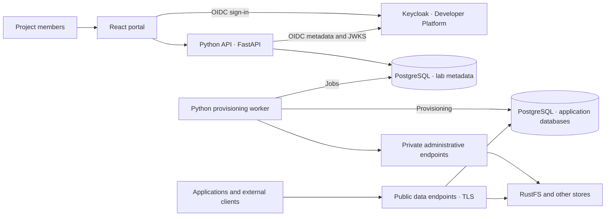

# Storage Lab

**Status:** Architecture and implementation proposal. No application code has been added to this repository yet.

Storage Lab is a proposed single-host platform for project-scoped data services. Project members would create projects, enable capabilities, and track provisioning in a React portal. A Python API would manage projects, authorization, and desired state, while a separate worker would provision resources. Applications on the Developer Platform and external clients would connect to the lab's public data endpoints with credentials issued for their workloads.

## Technology choices

- **API and worker:** Python, with FastAPI for the HTTP API, Pydantic for API contracts, SQLAlchemy for metadata persistence, and Alembic for schema migrations.
- **Portal:** React with TypeScript and Mantine. Vite builds the application; React Router handles navigation; TanStack Query manages API data and operation-status refreshes; `oidc-client-ts` handles browser OIDC with PKCE. Mantine supplies components, forms, and notifications.
- **Deployment:** Ansible provisions the development VM and prepares the guest. It will also deploy the API, worker, and portal when those applications exist.

The [technology decisions](docs/technology-decisions.md) explain each library's role. No application code has been added yet.

## Proposed architecture

The lab would use the Developer Platform's Keycloak for user sign-in. Lab projects would have their own IDs, memberships, and lifecycle. The metadata and application PostgreSQL instances would be separate services on the same lab host. The metadata instance would remain internal; public endpoints would expose only the application data services needed by clients.

## Planned capabilities

| Capability | Service | Project resource |
| --- | --- | --- |
| `postgresql` | PostgreSQL | Database |
| `object-storage` | RustFS | Private S3 bucket |
| `documents` | CouchDB | Database |
| `graph` | Apache HugeGraph | Graph |
| `vectors` | Qdrant | Collection |
| `key-value` | Valkey | Project key namespace |
| `search` | OpenSearch | Index or index prefix |
| `analytics` | ClickHouse | Database |
| `events` | NATS with JetStream | Account, streams, and consumers |

The initial API model allows at most one activation of each capability per project. Resource names derive from stable internal project IDs so display names can change without renaming data resources. Each service adapter must verify that it can provision, isolate, rotate credentials for, and remove its project resources before that capability is offered.

## Project workflow

1. An authorized member creates a project and enables a capability in the portal.
2. The API validates the request and stores the desired state and provisioning job together in PostgreSQL.
3. The worker reserves the job, creates the resource and its access policy, and verifies project-scoped access.
4. The portal shows each capability's status, connection details, and available data view. Project administrators can issue, rotate, and revoke workload credentials.

Provisioning is intended to be idempotent: retrying a request or resuming after an interrupted job must not create duplicate resources. Secret values would be shown only when issued, while status and audit records would contain references.

## Documentation

- [Project documentation](docs/architecture.md) covers components, access boundaries, provisioning, APIs, and operations.
- [Technology decisions](docs/technology-decisions.md) records the chosen Python and React stacks.
- [Implementation plan](docs/implementation-plan.md) defines delivery phases and acceptance criteria.
- [Local development VM](docs/development-vm.md) explains the Ansible-managed Ubuntu VM and guest setup.
- [German source concept](README_DE.md) records the original proposal.

The first delivery target is an end-to-end flow for two isolated projects using PostgreSQL and S3. Other capabilities follow after their service-specific isolation and lifecycle checks pass.

## Development environment

Run `ansible-playbook ansible/playbooks/dev-vm.yml` to create and start a local VM with 16 vCPUs and 32 GiB RAM. Then run `ansible-playbook ansible/playbooks/deploy.yml` to prepare the guest for application deployment. See the [VM guide](docs/development-vm.md) for host requirements and access details. The repository does not yet contain application services to deploy.
