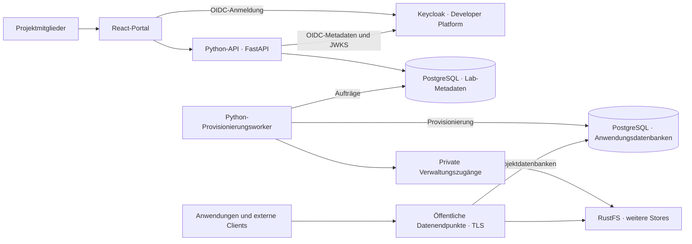

# Storage-Lab

**Status:** Architektur- und Umsetzungskonzept für ein eigenständiges Single-Host-Lab.

Das Storage-Lab stellt Anwendungen projektbezogene Datenbanken, Objektspeicher und spezialisierte Datendienste bereit. Projektmitglieder legen Projekte im React-Portal an, wählen Capabilities und verfolgen deren Bereitstellung. Die Python-API verwaltet Projekte, Berechtigungen und Ressourcen. Anwendungen auf der Developer Platform und externe Clients nutzen die öffentlichen Datenendpunkte des Labs mit eigenen Zugangsdaten.

## Architektur

- **React-Portal.** Projektübersicht, Capability-Auswahl, Bereitstellungsstatus, Verbindungsdaten, Zugangsdatenverwaltung und Links zu projektbezogenen Datenansichten.
- **Python-API.** FastAPI ist der vorgeschlagene Rahmen. Die API authentifiziert Benutzer, prüft Projektrollen und speichert Sollzustand und Aufträge transaktional. Das Portal ruft diese API auf.
- **PostgreSQL für die API.** Eine interne Instanz speichert Projekte, Mitgliedschaften, Capabilities, Ressourcenreferenzen, Aufträge und Audit-Einträge. API und Worker verwenden getrennte Rollen. Schemaänderungen laufen über versionierte Migrationen.
- **Provisionierungsworker.** Ein separater Python-Prozess übernimmt Aufträge aus dem Metadaten-PostgreSQL. Er nutzt dienstspezifische Adapter und private Verwaltungszugänge. Die Auftragswarteschlange kann im Metadaten-PostgreSQL liegen, sodass der Worker auch JetStream selbst bereitstellen kann.
- **Anwendungsdienste.** Eine zweite PostgreSQL-Instanz stellt die Projektdatenbanken bereit. RustFS und die weiteren Stores laufen ebenfalls im Storage-Lab. Jede Engine kann mehrere Lab-Projekte bedienen. Beide PostgreSQL-Instanzen teilen sich den Lab-Host.

Die Developer Platform stellt mit ihrem Keycloak den Identity Provider für die Anmeldung bereit. Ein Lab-Projekt hat eine eigene ID, eigene Mitgliedschaften und einen eigenen Lebenszyklus. Anwendungen verbinden sich über die im Lab ausgestellten Endpunkte und Zugangsdaten, die sie als Secrets erhalten.

## Capabilities

| Capability | Dienst | Ressource je Projekt | Projektberechtigung |
|---|---|---|---|
| `postgresql` | PostgreSQL für Anwendungen | Datenbank | Eigene Login-Rollen mit Zugriff auf diese Datenbank und die vorgesehenen Schemas |
| `object-storage` | RustFS | Privater S3-Bucket | Eigene Identität mit Policy für genau diesen Bucket |
| `documents` | CouchDB | Datenbank | Mitgliedschaft über `/{db}/_security` |
| `graph` | Apache HugeGraph | Graph | Projektgruppe mit Rechten auf den Graphen und die benötigten Operationen |
| `vectors` | Qdrant | Collection | Befristetes Token mit Collection-Rechten |
| `key-value` | Valkey | Projektspezifischer Schlüsselbereich | ACL für Schlüsselpräfixe und erlaubte Befehle. Datenbankbezogene ACLs sind eine Option nach Versionsprüfung. |
| `search` | OpenSearch | Index oder Indexpräfix | Indexrolle und bei Bedarf ein Dashboards-Tenant für gespeicherte Ansichten |
| `analytics` | ClickHouse | Datenbank | Rolle für Projekttabellen mit Abfragelimits |
| `events` | NATS mit JetStream | NATS-Account mit Streams und Consumern | Eigene Benutzer mit begrenzten Subject- und JetStream-Rechten |

Im ersten API-Modell gibt es je Projekt höchstens eine Aktivierung pro Capability. Die Ressourcennamen leiten sich aus einer stabilen internen Projekt-ID ab. Anzeigenamen können sich ändern. Ressourcenlimits werden je Dienst konfiguriert, soweit er sie auf Projektebene durchsetzen kann.

### PostgreSQL für Anwendungen

1. Der Worker legt auf der **Anwendungsinstanz** je Projekt eine Datenbank und eine separate Eigentümerrolle ohne Login an. Die Provisionierung verwendet eine eigene Datenbankverwaltungsrolle auf dieser Instanz.
2. Er entzieht `PUBLIC` das standardmäßige `CONNECT`-Recht auf der Projektdatenbank und vergibt es gezielt an die zuständigen Rollen. Der öffentliche TLS-Zugang zur Anwendungsinstanz erlaubt nur Projektrollen für ihre freigegebenen Datenbanken. Die Freigabe erfolgt nach der Rechtekonfiguration.
3. Eine Migrationsrolle erhält die benötigten DDL-Rechte. Die Laufzeitrolle erhält nur die für die Anwendung benötigten Schema- und Objektrechte. Standardrechte für später erzeugte Objekte werden für die tatsächlich erzeugende Rolle festgelegt. Anwendungsrollen erhalten weder Superuser- noch Rollen- oder Datenbankverwaltungsrechte.
4. Das Portal zeigt Host, Port, Datenbankname und Benutzer an. Der Client verbindet sich mit TLS und Hostnamenprüfung, bei libpq etwa über `sslmode=verify-full`. Passwörter werden über einen gesonderten Ausstellungs- oder Rotationsvorgang übergeben.

`CREATE DATABASE` läuft außerhalb eines Transaktionsblocks. Bei einer Unterbrechung liest der Worker den Istzustand und prüft Eigentümer sowie Rechte, bevor er fortfährt. [PostgreSQL-Datenbankanlage](https://www.postgresql.org/docs/current/sql-createdatabase.html) · [PostgreSQL-Berechtigungen](https://www.postgresql.org/docs/current/ddl-priv.html)

### S3 über RustFS

1. Der Worker legt einen privaten Bucket und eine Projektidentität in der **RustFS-Instanz des Labs** an. Je Anwendung kann er ein eigenes Zugangspaar ausstellen.
2. Die Policy bindet Bucket-Operationen wie Auflisten an den Projekt-Bucket und Objektoperationen wie Lesen oder Schreiben an dessen Objektpfad. Das Portal stellt S3-Endpunkt, Bucket, Region und bei Bedarf Hinweise zum Adressierungsmodus bereit.
3. Die Projektansicht listet Objekte auf und unterstützt Upload und Download. Für direkte Browser-Transfers kann das Backend nach einer Projektberechtigungsprüfung kurzlebige signierte URLs ausstellen. Das S3-Ende erlaubt dafür bei Bedarf die Portal-Origin per CORS.
4. Vor der Freigabe prüft der Adapter mit der vorgesehenen RustFS-Version, dass Bucket-Anlage, Policy-Zuordnung, Ausstellung und Widerruf von Zugangsdaten automatisierbar sind. [RustFS IAM](https://docs.rustfs.com/en/security-compliance/iam)

## Bereitstellung über das Portal

1. Ein Projektmitglied mit Verwaltungsrecht legt ein Projekt an und wählt Capabilities. Das Portal zeigt für jede Capability ihren eigenen Status.
2. Die API prüft Berechtigung und Parameter. Sie legt die Capability und den zugehörigen Auftrag gemeinsam in PostgreSQL ab. Ein Wiederholungsaufruf mit demselben Ziel erzeugt keine zweite Ressource.
3. Der Worker reserviert den Auftrag befristet, legt Ressource und Rechte an und prüft den projektspezifischen Zugang. Wenn er nach einer Teiloperation ausfällt, kann ein weiterer Versuch anhand der stabilen Ressourcen-ID fortsetzen.
4. Bei Erfolg erscheinen Endpunkt, Ressourcenname und Datenansicht. Bei einem Fehler zeigt das Portal die betroffene Capability mit einer verständlichen Ursache und bietet eine Wiederholung an. Andere Capabilities behalten ihren Status.
5. Projektverwalter können Zugangsdaten ausstellen, rotieren und widerrufen. Vor dem Löschen zeigt das Portal die betroffene Ressource und fragt eine ausdrückliche Bestätigung ab. Für NATS-Accounts, Buckets und Datenbanken prüft der Worker auch die zugehörigen Zugangsdaten und Ressourcen.

| Vorgeschlagene API-Operation | Funktion |
|---|---|
| `POST /projects` | Projekt anlegen |
| `GET /projects/{project_id}` | Projekt und Bereitstellungsstatus lesen |
| `PUT /projects/{project_id}/capabilities/{kind}` | Capability aktivieren oder denselben Auftrag wiederverwenden |
| `GET /projects/{project_id}/capabilities/{kind}` | Status, Endpunkt und Ressourcenreferenz lesen |
| `POST /projects/{project_id}/capabilities/{kind}/credentials` | Zugang für einen Workload ausstellen |
| `DELETE /projects/{project_id}/capabilities/{kind}/credentials/{credential_id}` | Zugang widerrufen |
| `DELETE /projects/{project_id}/capabilities/{kind}` | Bestätigten Löschauftrag starten |

Asynchrone Änderungen liefern eine Auftrags-ID. Das Portal liest den Status über `GET /operations/{operation_id}`. Passwort- und Schlüsselwerte erscheinen ausschließlich beim Ausstellen. Ressourcenstatus und Audit-Protokoll enthalten lediglich Referenzen.

## Internetzugriff und Dashboards

- **Portal und API.** Das React-Portal meldet Benutzer beim Keycloak der Developer Platform per OIDC Authorization Code mit PKCE an. Das Lab erhält einen eigenen Portal-Client und eine eigene API-Audience. Die Python-API prüft Signatur, Issuer, Audience und Gültigkeit des Access-Tokens. Sie ordnet die Identität über `(iss, sub)` einer Lab-Mitgliedschaft zu und prüft die lokale Projektrolle bei jedem Zugriff, einschließlich Auftragsstatus und Dashboard-Aufrufen. Ein Projektmitglied kann seinen Ressourcenzugriff unabhängig vom Workload-Zugang erhalten.
- **Öffentliche Datenendpunkte.** DNS-Namen je Dienst, TLS mit Hostnamenprüfung und dienstseitige Authentifizierung. HTTPS und WSS können über einen Reverse Proxy laufen. PostgreSQL und Valkey verwenden eigene TLS-Datenports. NATS kann zusätzlich zu WSS einen nativen TLS-Port anbieten.
- **Verwaltungszugänge.** Die PostgreSQL-Instanz für Metadaten ist nur intern für API, Worker und autorisierte Betriebsrollen erreichbar. Verwaltungsoberflächen und Clusterports liegen im internen Netz oder hinter einem gesonderten Admin-Zugang. Bei gemeinsamem HTTP-Einstieg werden Verwaltungsrouten am öffentlichen Proxy gesperrt, soweit sie vom Datenpfad getrennt sind. Die Dienste selbst setzen Projektberechtigungen auch für direkte API-Aufrufe durch.
- **Projektansichten.** PostgreSQL erhält eine Ansicht für Verbindungsdaten und bei Bedarf eine projektgebundene SQL-Oberfläche. S3 erhält einen Objektbrowser. Für die übrigen Dienste können Fauxton, Hubble, Qdrant Web UI, Valkey Admin, OpenSearch Dashboards, ClickHouse SQL-Konsole und NUI angebunden werden, wenn sie mit einer eingeschränkten Projektidentität funktionieren. Bei fehlender Projektisolation übernimmt das Portal die benötigte Ansicht über die jeweilige API.

## Umsetzung und Abnahme

1. **Erster durchgängiger Ablauf.** React-Portal, Python-API, beide PostgreSQL-Instanzen und Worker aufsetzen. Anmeldung über den Keycloak der Developer Platform prüfen. Zwei Projekte anlegen und je eine PostgreSQL-Datenbank auf der Anwendungsinstanz sowie einen S3-Bucket bereitstellen.
2. **Projektgrenzen prüfen.** Projekt A kann über die öffentlichen Endpunkte Daten schreiben und lesen. Die Metadateninstanz ist von außen unerreichbar. Zugriffe auf die Projektdatenbank, den S3-Bucket, das Dashboard und Auftragsinformationen von Projekt B werden abgewiesen. Die API weist Tokens für eine fremde Audience ab und verweigert gültig angemeldeten Benutzern ohne passende Lab-Mitgliedschaft den Projektzugriff.
3. **Wiederanlauf prüfen.** Den Worker zwischen Ressourcenanlage und Rechtevergabe unterbrechen. Nach Wiederanlauf entsteht genau eine nutzbare Ressource. Metadaten und Stores erhalten eigene Backup- und Wiederherstellungsverfahren, einschließlich eines Abgleichs zwischen Metadaten und tatsächlichen Ressourcen.
4. **Weitere Adapter ergänzen.** Für jede Engine Bereitstellung, isolierten Zugriff, Rotation, Widerruf und Löschung testen. Bei JetStream gehört ein Test mit getrennten NATS-Accounts dazu. Dashboard-Integration ist abgeschlossen, wenn dieselben Projektgrenzen auch im Browser greifen.
